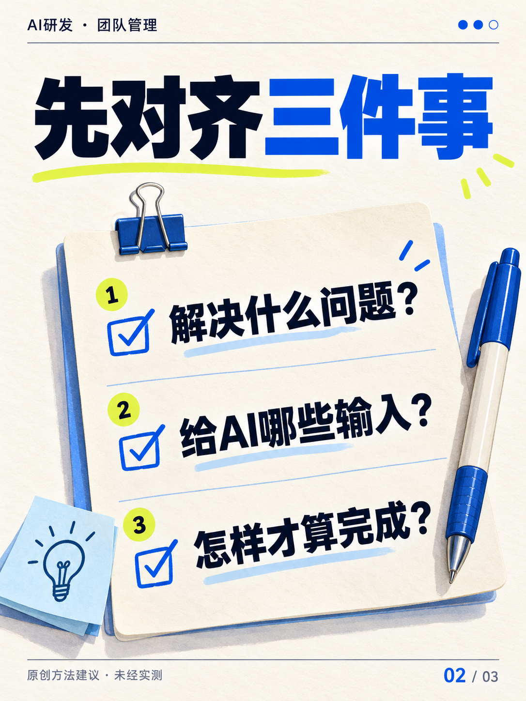
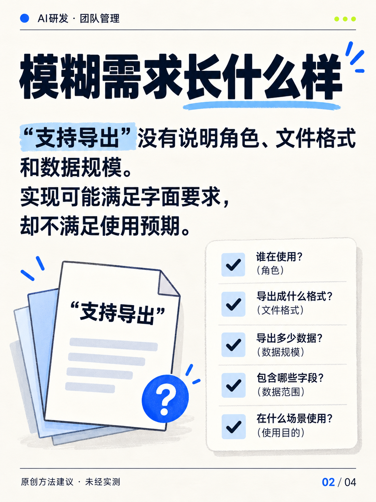
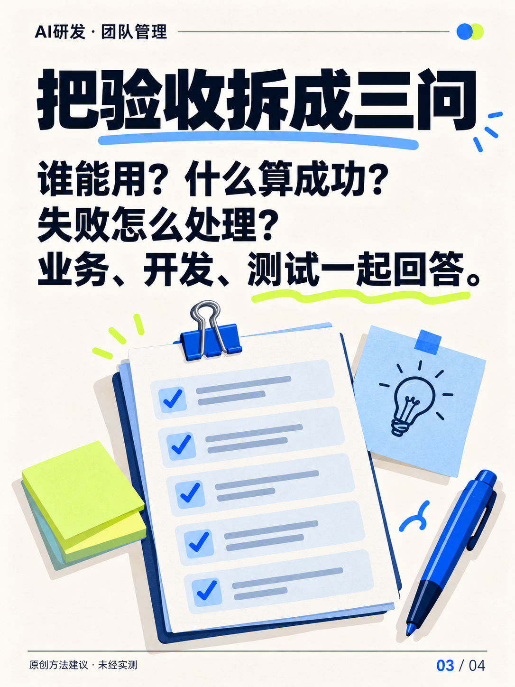
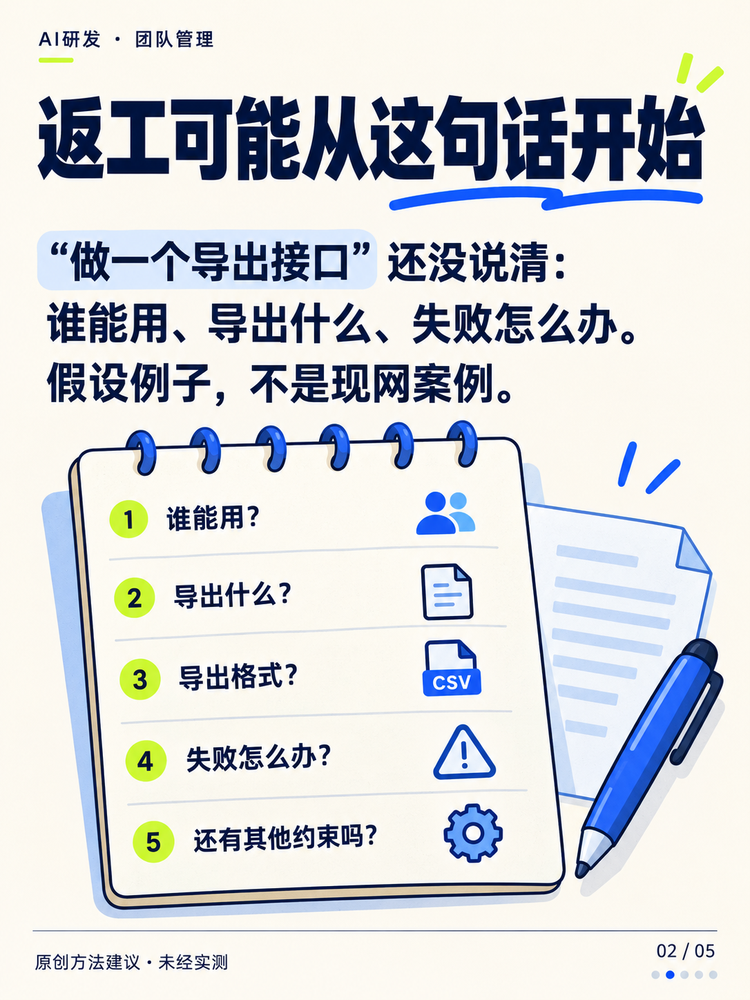
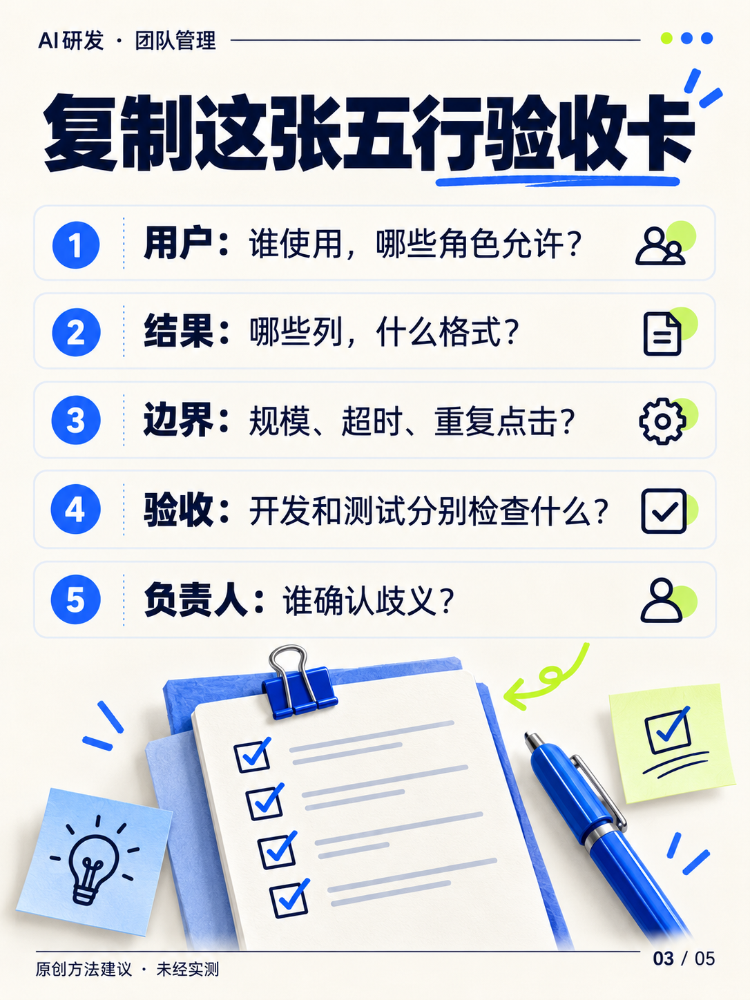
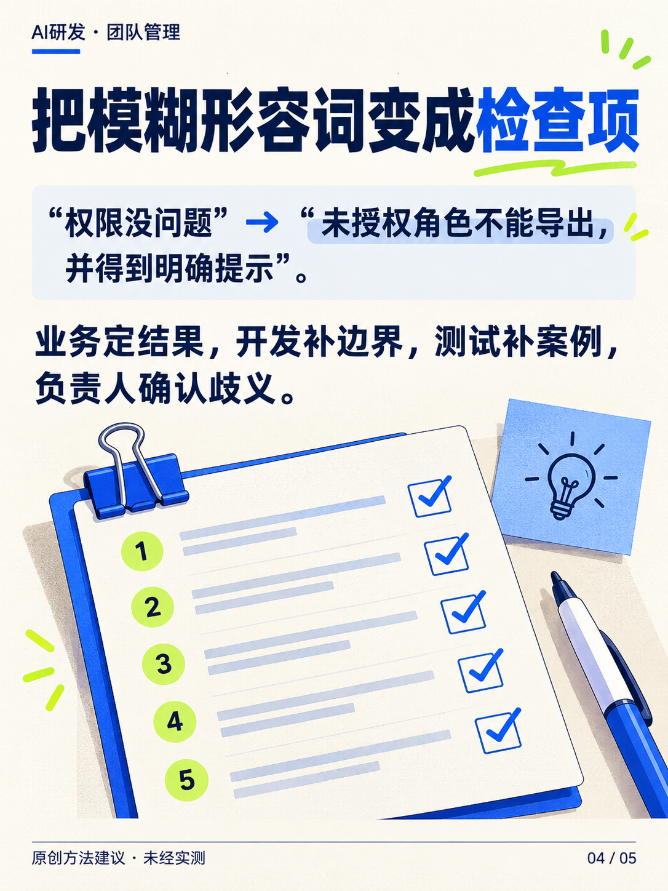
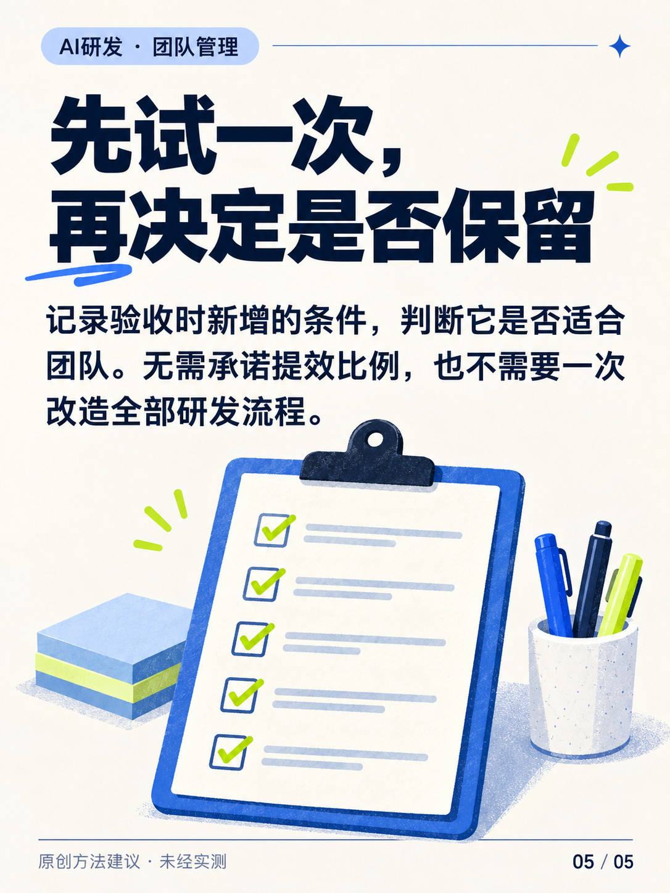

# 小红书三版实际配图归档

补交日期：2026-10-11。V1 3 张、V2 4 张、V3 5 张，共 12 张。

[完整正文、历史优化点与评分](../xiaohongshu-iterations.md)

图片使用内置 imagegen 生成，属于原创方法卡，不是视频截图或人物原话。文案历史评分 51 → 76 → 82 保持不变；补图不等于实际发布或提效验证。

## 图片生成规格

统一 3:4 竖版、米白纸纹、深蓝中文粗体、钴蓝强调和少量荧光绿。每页使用历史快照中的完整标题和逐页文字；封面以电脑、纸质验收清单和勾选动作为插画，内页按三问、五行验收卡或前后对比排版。所有图片标注“原创方法建议 · 未经实测”。

## V1：AI工具上了，团队为什么还在返工

### 第 1 页：用了AI，为什么还是忙？

[打开原图](v1-01.png)

### 第 2 页：先对齐三件事

[打开原图](v1-02.png)

### 第 3 页：开始前写下来

[打开原图](v1-03.png)

## V2：AI写得快，验收为什么总卡住

### 第 1 页：代码写快了，验收却卡住了

[打开原图](v2-01.png)

### 第 2 页：模糊需求长什么样

[打开原图](v2-02.png)

### 第 3 页：把验收拆成三问

[打开原图](v2-03.png)

### 第 4 页：给AI可检查的输入

[打开原图](v2-04.png)

## V3：给AI任务前，先写这张验收卡

### 第 1 页：先写验收卡，再让AI写代码

[打开原图](v3-01.png)

### 第 2 页：返工可能从这句话开始

[打开原图](v3-02.png)

### 第 3 页：复制这张五行验收卡

[打开原图](v3-03.png)

### 第 4 页：把模糊形容词变成检查项

[打开原图](v3-04.png)

### 第 5 页：先试一次，再决定是否保留

[打开原图](v3-05.png)

## 逐张核对记录

每张检查标题、正文、页码与安全边界。核对结果见同目录 `visual-review.json`。图片保留生成尺寸，比例均为 3:4；尚无小红书发布反馈。
